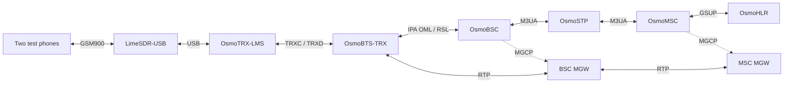

# Native GSM lab on Apple Silicon macOS

[](https://github.com/can-yesilyurt/osmocom-macos-lab/actions/workflows/checks.yml)
[](https://github.com/can-yesilyurt/osmocom-macos-lab/actions/workflows/native-build.yml)

Build and run a local Osmocom 2G network on macOS with a **LimeSDR-USB**, using
OsmoTRX-LMS, OsmoBTS, OsmoBSC, OsmoSTP, OsmoMSC, OsmoHLR and two OsmoMGWs.
The daemons run as native ARM64 processes without a VM, container or root access.

**Bring-up result:** two iPhones registered on the native macOS network. The
operator confirmed successful calls and SMS between them. A fresh build of the
pinned sources and a core-only startup/shutdown check also passed. See the
[validation report](docs/VALIDATION.md) for evidence, skipped tests and limits.

This repository packages the integration, build recipe and operating procedure.
It builds on the [Osmocom community's software](https://osmocom.org/) and
[Andrei Gosman's macOS ARM64 ports](https://github.com/AndreiGosman), including
his existing BTS hardware validation. See [credits and porting notes](docs/PORTING.md).

## Tested setup

| Item | Validated configuration |
| --- | --- |
| Host | Apple M5 Max, ARM64, macOS 27.0.1 |
| Toolchain | Apple clang 21.0.0, macOS SDK 27.0, ARM64 Homebrew |
| Radio | LimeSDR-USB, LimeSuite 23.11.0, internal reference clock |
| Air interface | One GSM900 carrier, ARFCN 25, GSM full-rate voice, SMS |
| Handsets | Two iPhones; registration checked in daemons, calls/SMS operator confirmed |
| Core transport | SCTP compatibility layer over loopback UDP; separate encapsulation ports per process |

An independent clean build and core-only smoke check also
[passed on a hosted ARM64 Mac running macOS 26.6.2](https://github.com/can-yesilyurt/osmocom-macos-lab/actions/runs/39931415240),
using the functional CI timer mode and no SDR. Radio operation on other Macs,
macOS releases, radios and bands needs its own validation. This recipe currently
accepts GSM900 ARFCNs 1–124. GPRS/EDGE, 3G/LTE/5G, roaming and
external telephone interconnect are outside the tested profile.

## Build

Install the Xcode Command Line Tools and [Homebrew](https://brew.sh/) first.
Use a checkout and state directory without spaces. The short state path also
avoids macOS's Unix-domain socket path limit.

```sh
git clone https://github.com/can-yesilyurt/osmocom-macos-lab.git
cd osmocom-macos-lab
export OSMO_LAB_STATE="$HOME/osmolab-state"
brew bundle --file=Brewfile
./lab doctor
./lab build --jobs 6
cp lab.example.json lab.json
nano lab.json
./lab configure
./lab core --check
```

Set the same `OSMO_LAB_STATE` in every terminal. Omit it to keep all state in
`.lab/` under a sufficiently short checkout. Once built, keep the state directory
at that path: installed dylibs contain absolute install names.

The build downloads **13 checkouts pinned to full Git commits**, uses four
separate library prefixes, and runs the supported component regression checks.
Homebrew dependencies are version-recorded in the validation report rather than
locked. See [build details and resuming a build](docs/BUILD.md).

## Configure and start

Edit the private `lab.json` for your authorized or RF-contained lab. The example
MCC `001`, MNC `01` and ARFCN `25` are placeholders. `device_args` may be left
empty when exactly one LimeSDR is attached, or set locally to `serial=YOUR_SERIAL`.
`tx_path` and `rx_path` must match the actual LimeSDR connectors and band.

Every configuration render starts with **`rf_locked 1`**. Lab defaults create
subscribers on demand, make SIM authentication optional and use A5/0. Read the
[operating notes](docs/OPERATIONS.md) before admitting handsets.

Run these in separate terminals from this checkout, with the same environment:

```sh
# Terminal 1: six core daemons; Ctrl+C stops this group
./lab core

# Terminal 2: LimeSDR transceiver
./lab trx

# Terminal 3: BTS
./lab bts

# Terminal 4: inspect links, then explicitly enable the configured carrier
./lab status
./lab rf on
```

`rf on` checks the core and radio links, uses OML-controlled attenuation and
unlocks the carrier for that session. It does not save an unlocked startup
configuration. Allow the transceiver to initialize before enabling RF, then run
a manual network scan on the test phones. Handsets may display the PLMN code
instead of `OSMO-TEST` before registration.

```sh
./lab status
./lab rf off
```

`rf off` locks/mutes the carrier; SDR streams can remain open. For a full stop,
press Ctrl+C in the BTS, TRX and core terminals, in that order. `core --check`
starts a temporary core and stops it after checking links. Use `status` to inspect
a core that is already running.

## Topology



## Checks and local data

```sh
python3 -B -m unittest discover -s tests -v
python3 scripts/check_publication.py
# After building and configuring, with the management ports free:
python3 -B scripts/smoke_native.py
```

The native smoke check starts the core, verifies its links, checks that a second
launcher cannot replace it, and parses the real BTS configuration in VTY test
mode. It never launches the transceiver or enables RF. The manually triggered
native-build CI workflow runs the same check; handset/RF tests remain local.
The cloud build uses a functional timer delivery/disarm probe in place of the
port's two strict timing programs, which failed on the hosted VM. The default
physical-host build runs both original programs. See [the recorded limitation](docs/VALIDATION.md).

Profiles, subscriber/SMS databases, logs, source downloads and binaries stay in
ignored local state. Never attach raw HLR/MSC logs or databases to public issues:
they can contain subscriber identifiers and message content. Publish a redacted
summary like the [included validation snapshot](validation/2026-10-23/summary.json).

The [MIT license](LICENSE) covers this repository's original orchestration and
documentation. External sources and their modifications retain their own
licenses; see [NOTICE](NOTICE).
